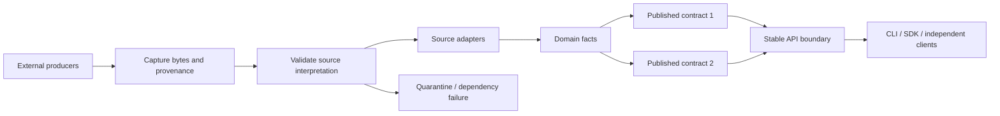

# Data contract evolution when upstream changes independently

Research date: 2026-10-20. This document separates **observed mechanisms** in primary documentation from **recommended architecture** and **original failure analysis**. Examples and policy names are illustrative unless explicitly attributed. It does not claim that Azure or Astronomer implements this entire design internally.

## 1. The actual object of compatibility

The difficult failure is not a new gateway deployment. It is a new upstream record arriving through an unchanged endpoint and producing a response that an unchanged installed client can no longer interpret correctly.

Model the serving operation as:

```text
source bytes + source interpretation
  -> source adapter
  -> internal facts
  -> requested public projection
  -> serialized response
  -> client decoder
  -> user workflow
```

Every arrow can change behavior. A schema registry protects only selected relationships in that chain. An unchanged OpenAPI document protects none of the arrows by itself. A public promise therefore needs both a definition and an enforcement point.

For a given supported consumer, compatibility means more than successful parsing:

1. It can decode the response.
2. It receives the fields and values it was promised.
3. Units, identity, time interpretation, completeness, and meaning remain within that promise.
4. A read-modify-write operation does not destroy information the consumer cannot see.
5. Errors, partial results, and stale results remain distinguishable from successful complete results.

The endpoint's HTTP contract and the returned dataset's contract may have separate lifecycles. Keeping them separate is useful when many independently evolving datasets share a generic query or download service. For a narrowly defined resource API, binding its data contract to the API version is often simpler.

## 2. Keep the identities distinct

Recommended identifiers:

| Identifier | What it answers | What it does not establish |
|---|---|---|
| HTTP API version | Which operations, envelope, error model, and protocol behavior apply? | Which source schema generated a row? |
| Published data-contract version | Which business fields, meanings, grain, and invariants are promised? | Exactly which records are included today? |
| Structural schema identifier | Which machine-readable structure is this payload using? | Whether field meanings are unchanged |
| Writer/source revision | How should this particular source payload be decoded? | Whether its contents satisfy publication requirements |
| Transformation revision | Which mapping and reference-data rules produced the output? | Whether the output is currently selected for serving |
| Publication/snapshot identifier | Which coherent published data state is selected? | Whether the user's current authorization allows access |
| SDK/CLI release | Which consumer implementation is installed? | Which dataset contract the caller requested |

Do not overload one integer named `version` with all of these meanings. A structural schema hash needs a specified canonicalization algorithm and scope. Hashing types and property names cannot detect an upstream business-definition change that leaves those types and names identical.

A registry identifier is an identifier within the registry's identity domain. If artifacts move between environments, preserve a registry namespace or stable artifact identity instead of assuming an unqualified numeric ID has the same meaning everywhere.

## 3. Choose the public data surface deliberately

### 3.1 Curated business data

Recommended flow:



The public shape is owned by the platform. Upstream field names are implementation details unless explicitly adopted into the public contract. Maintain several small domain models rather than a single universal enterprise object that absorbs every source's vocabulary.

Example: source A reports `gross_cents`, source B reports decimal text plus currency, and the API promises an amount in minor units. These are interchangeable only after a reviewed mapping establishes currency, scale, signs, rounding, inclusion of taxes, and refunds. A conversion that preserves type but changes gross to net is a contract violation.

### 3.2 Dynamic query results

The platform can promise a stable result envelope while letting columns vary by query, dataset, or tenant. The SDK exposes a generic result abstraction; business-specific typed models are optional conveniences with their own contract requirements.

An original example:

```json
{
  "dataset": "orders",
  "contract": "orders/2",
  "schema": "orders-columns/12",
  "publication": "pub-00847",
  "as_of": "2026-10-20T12:00:00Z",
  "completeness": "complete",
  "columns": [
    {"id": "order-id", "name": "order_id", "type": "string"},
    {"id": "gross-amount", "name": "gross_minor", "type": "int64"}
  ],
  "rows": [["o-123", 1250]]
}
```

The distinction must reach users: a generic CLI can display a new column without upgrading, but a shell script that assumes a particular column name remains a data-contract consumer. A Python `dict` return value does not make arbitrary downstream business logic compatible.

Specify exact encodings for integers, decimals, timestamps, bytes, non-finite numbers, and nulls. A type descriptor without corresponding wire semantics is incomplete. For example, JSON numeric values that fit the server's integer type may exceed an intermediary's exact-number range. Test the actual path through the gateway, client, dataframe conversion, and export format.

## 4. Compatibility direction is a relation between readers and writers

**Observed:** Confluent defines backward compatibility as a new reader accepting older writer data; forward compatibility is an old reader accepting newer writer data. Full combines both. Transitive policies compare with all previous subject versions; the default `BACKWARD` compares with the previous version. Rules depend on the serialization format and schema details. [Confluent schema evolution](https://docs.confluent.io/platform/current/schema-registry/fundamentals/schema-evolution.html)

Use the relation explicitly in design reviews:

```text
R_new(W_old(record))   # historical replay through a new consumer
R_old(W_new(record))   # old installed client receives new data
```

For the user's primary requirement, the second relation is necessary. For replay, the first is necessary. Neither expression proves that a downstream calculation or command remains correct.

Recommended policy selection:

| Situation | Needed evidence |
|---|---|
| New consumer replays historical events | New reader with every retained writer schema and representative data |
| New producer sends to old installed readers | Every supported old reader against candidate writer values |
| Mixed producer/consumer rollouts | Both relations for the actual supported matrix |
| Public HTTP JSON served from internal Avro | Internal compatibility plus independently verified JSON/client behavior |
| Breaking producer change that cannot satisfy old readers | New publication/topic/contract plus explicit adapter or migration |

Do not force every internal event subject into the strictest policy by reflex. A separate contract or stream can be more honest than a transformation that fabricates missing information. Conversely, selecting a transitive mode is valuable when long-lived readers or replay history span many schema revisions.

### 4.1 Defaults differ by format

**Observed:** Avro decoding uses writer and reader schemas. Reader defaults can supply fields absent from the writer; an encoding-time default does not make writing a field optional. Nullable unions and missing-field defaults solve different problems. Refer to the pinned Avro version for union-default details. [Avro 1.12 specification](https://avro.apache.org/docs/1.12.0/specification/)

**Observed:** JSON Schema's `default` is an annotation; validation itself does not fill absent values. Object properties are optional unless required, and extra properties are allowed unless constrained. [JSON Schema annotations](https://json-schema.org/understanding-json-schema/reference/annotations), [JSON Schema objects](https://json-schema.org/understanding-json-schema/reference/object)

Original failure example: a platform adds `currency` with a schema annotation `default: USD`, assumes all consumers now receive USD, and emits no currency. Some SDKs populate the default, others leave it absent, and raw curl clients receive nothing. The server must implement any public default behavior explicitly, or the API must document absence with a precise meaning. Test omission and explicit null separately.

### 4.2 Binary compatibility does not imply JSON compatibility

**Observed:** Protobuf field numbers identify fields on the binary wire; reusing retired numbers is unsafe. ProtoJSON has different evolution properties: unknown fields are rejected by default, with an optional ignore behavior, and names are part of its representation. [Protobuf language guide](https://protobuf.dev/programming-guides/proto3/), [ProtoJSON format](https://protobuf.dev/programming-guides/json/)

Original failure example: an internal team adds a field and confirms old binary consumers still work. A gateway converts every message to ProtoJSON. Older Python clients reject the newly emitted field. The integration needs JSON-specific compatibility fixtures and controlled projection, even though the protobuf change passed its internal check.

Do not infer semantic safety from a permitted numeric type conversion. A value within the old range might work while tomorrow's larger value fails or loses information. The rollout gate must cover the new value domain, not only the schema declaration.

## 5. A registry is one enforcement point, not a runtime firewall

Recommended enforcement map:

| Boundary | Input | Enforcement | Failure action |
|---|---|---|---|
| Contract proposal | Candidate schema + supported history | Format-specific compatibility comparison | Reject publication of candidate |
| Producer serialization | Application object | Actual serializer and payload validation | Reject or isolate bad record |
| Ingestion | External bytes + declared schema | Decode, identity check, structural checks | Capture evidence, quarantine or fail request |
| Normalization | Decoded source value | Semantic mapping preconditions | Explicit mapping error |
| Dataset publication | Candidate batch/snapshot | Completeness, uniqueness, reconciliation, freshness | Keep candidate unpublished |
| API serving | Requested projection | Response conformance and authorization | Controlled data/dependency error |
| Consumer workflow | Response | Historical client tests and business invariants | Release gate or client error |

An external vendor can bypass your registry entirely. An internal producer can register a schema and then send bytes that do not match it. A gateway can transform a valid internal record into invalid public output. These are distinct faults and need distinct checks.

Sampling is useful for observing drift and controlling cost, but sampled validation cannot establish that every response conforms. Decide where full validation is necessary: a high-risk numeric aggregate may need strict publication checks; an exploratory lake ingestion stream may tolerate incomplete records if that is visible and expected.

## 6. Tolerant ingestion and strict publication are complementary

**Observed:** Databricks Auto Loader supports preserving unexpected data in a rescued-data column. Its inference and evolution behavior is configurable and depends on format and runtime. [Auto Loader schema inference and evolution](https://docs.databricks.com/aws/en/ingestion/cloud-object-storage/auto-loader/schema)

**Observed:** dlt exposes `evolve`, `freeze`, `discard_row`, and `discard_value` policies; policy scope includes tables, columns, and types. Discarding nested records may leave parent records loaded. [dlt schema contracts](https://dlthub.com/docs/general-usage/schema-contracts)

Recommended separation:

```text
raw capture may accept a newly observed shape
    != normalization knows what that shape means
    != the curated publication is complete
    != the existing public contract permits the new shape
```

Do not configure automatic evolution on the final public table and assume that means the API is protected. Configure evolving raw storage and a deliberately maintained published projection.

### 6.1 Quarantine granularity is a correctness decision

| Product | Reasonable default for a malformed record | Why |
|---|---|---|
| Search over independent documents | Isolate document and expose indexing lag/error accounting | One document may not invalidate unrelated results |
| End-of-day financial total | Block the affected complete publication | Dropping one expensive order can materially change totals |
| Inventory reservation | Reject operation or use authoritative dependency | A stale value can produce an incorrect reservation |
| Exploratory analytics | Allow partial data only with explicit completeness metadata | User can choose whether partial evidence is useful |

Define an invalidity unit: record, entity, partition, batch, tenant, or entire data product. Also define recovery ordering. If event 12 is quarantined and event 13 updates the same entity, allowing 13 through may create a state that cannot be repaired by simply replaying 12 later.

Record invalid counts, affected time ranges, source IDs, reasons, and retry status. Avoid a single `partial: true` flag that hides whether 1 row or 90% of the dataset is missing.

### 6.2 Schema inference cannot infer a contract

A sample containing only whole-dollar amounts does not establish an integer domain. A field that is absent from every sampled row is not necessarily removed. A new column with the same values as an old one is not proof of a rename. Inference generates a hypothesis about observed structure; a producer declaration or reviewed rule establishes meaning.

Recommended unknown-source policy: preserve evidence, classify known versions using unambiguous discriminators, and fail ambiguous classification. Never choose whichever parser happens to accept a record first when several interpretations have different semantics.

## 7. Stable physical identity and stable public names solve different problems

**Observed:** Iceberg assigns unique field IDs so that additions, drops, and reordering do not accidentally associate existing values with another column. [Iceberg schema evolution](https://iceberg.apache.org/docs/latest/evolution/)

Original example:

```text
physical field id 41: customer_id -> account_id
public contract 1: still returns customer_id
public contract 2: returns account_id
```

Physical files may remain safely readable, but a SQL query using `customer_id` or a CLI filter referencing that name may fail if the public name changes. Preserve aliases through a view or serializer for the supported old contract. Do not reuse a retired field's identity for a different business meaning merely because its old display name is convenient.

Stable IDs are especially useful in dynamic tables where display names can change. If exposed, specify whether an ID remains stable across source replacement, copy, tenant, and contract major. A source field ID should not silently become the public business field ID if multiple sources are merged.

## 8. SQL model contracts and expand/migrate/contract

**Observed:** dbt model contracts validate declared column names and types during a build. Additional constraint enforcement varies by warehouse and materialization; a declared constraint may be metadata only. Model versions permit separate versions and explicitly pinned references. [dbt model contracts](https://docs.getdbt.com/docs/mesh/govern/model-contracts), [dbt model versions](https://docs.getdbt.com/docs/mesh/govern/model-versions)

Recommended migration for a source amount representation change:

1. **Expand:** add the new internal representation without removing the old readers' required information.
2. **Dual-read/dual-write deliberately:** choose one authoritative representation and derive the other, or reconcile discrepancies. Two independently writable columns without precedence rules create drift.
3. **Backfill:** convert existing rows with checkpoints and idempotency. Record which conversion revision handled each partition.
4. **Publish v2 alongside v1:** explicit views or tables select fields and implement semantics.
5. **Migrate consumers:** measure usage and validate real workflows.
6. **Contract:** remove obsolete storage only after the support and rollback windows permit it.

Avoid `SELECT *` in published contracts that promise a stable shape. Use explicit projection and explicit casts, plus actual data checks for casts that may truncate, overflow, or replace invalid values with null.

Pinning a dbt model version means choosing its logical contract; it does not freeze the dataset rows. An unversioned reference that follows a latest version is a moving dependency. Align that behavior with the consumer's needs rather than assuming all references are pinned.

A SQL view is evaluated over its dependencies. If an uncontrolled source drops a required column, an old view can fail without changing its definition. A materialized validated publication can isolate availability from that immediate failure, at the cost of staleness and storage. This is an architectural tradeoff, not a universally better choice.

## 9. Historical data requires historical interpretation

**Observed:** Debezium's MySQL connector retains schema history to interpret events using the database structure at their binlog position. Its internal schema-history topic is distinct from the consumer-facing schema-change topic. [Debezium MySQL connector](https://debezium.io/documentation/reference/stable/connectors/mysql.html)

Recommended record provenance:

```text
source system and tenant
source record/event identity
source log position or sequence if available
source event time and ingestion time
writer schema identity
raw payload location / retention class
normalizer revision
reference-data revision
published contract and publication identity
```

An archive of bytes is insufficient if decoding depends on a deleted schema, expired decryption key, unavailable lookup table, or lost timezone interpretation. Treat all of those dependencies as part of replay readiness.

Preserve source ordering only to the extent the source actually provides it. Arrival order is not necessarily business-event order. A primary-key change can be a change of entity identity, not merely a new string field. Deletes and tombstones have semantics distinct from absent or null records. A replay plan must include these cases, not only inserts.

### 9.1 Upcasters and versioned projections

**Observed:** Axon documents revision-aware upcaster chains that transform stored events during reading, preserving the stored historical events. [Axon event versioning](https://docs.axoniq.io/axon-framework-reference/4.12/events/event-versioning/)

Recommended pattern:

```text
stored event rev1 -> upcast 1-to-2 -> upcast 2-to-3 -> current projector
stored event rev2 -----------------> upcast 2-to-3 -> current projector
stored event rev3 --------------------------------> current projector
```

Keep transformations deterministic where possible. If an upcaster needs an exchange rate, product mapping, or timezone rule, specify the historical reference revision. Calling today's external lookup while replaying yesterday's events can generate a different history.

Long chains cost runtime and maintenance. An optimized migration can materialize a new derived stream or snapshot while retaining the original history and lineage. Validate equivalence before replacing the chain in production. Event reprocessing must suppress or deduplicate external side effects; rebuilding a projection must not send every historical email again.

### 9.2 Downcasts are often partial functions

Define transformations as functions with preconditions:

```text
to_v1(current_record) -> v1_record OR explicit unrepresentable error
```

Example: v1 permits integer seconds and v2 permits millisecond precision. `30500 ms` cannot be represented exactly as integer seconds. Options include a documented rounding policy already compatible with v1, a restriction on values created while v1 support exists, retaining a meaningful separate v1 value, or returning a specific incompatibility response. Silent truncation is not an automatic compatibility solution.

Another example: v1 has one `owner_id`; v2 allows several owners. Selecting an arbitrary first owner may cause an old client to grant access to the wrong user. A valid mapping requires a business rule, and sometimes no truthful mapping exists.

The presence of adapters does not eliminate these constraints. It concentrates the decisions into a place where they can be reviewed and tested.

## 10. Atomic publication needs a defined scope

**Observed:** Iceberg commits update a table's metadata atomically and readers use a consistent table snapshot. [Iceberg reliability](https://iceberg.apache.org/docs/latest/reliability/)

Recommended publication sequence for a data product composed of several tables:

1. Build immutable candidate table snapshots.
2. Verify schema and domain checks across those specific snapshots.
3. Write an immutable publication manifest naming each table snapshot, contract, adapter revision, and validation report.
4. Atomically compare-and-swap the data-product pointer to that manifest.
5. Have serving requests resolve the pointer once and use its selected snapshots throughout the operation.

This extra manifest is needed when the storage system does not provide the required multi-table transaction. Atomicity of each individual table does not prove atomicity of a join across several independently updated tables.

An original manifest shape:

```json
{
  "publication": "orders-pub-847",
  "contract": "orders/2",
  "tables": {"orders": "snapshot-19", "refunds": "snapshot-27"},
  "transform_revision": "map-8",
  "validation_report": "report-847",
  "status": "validated"
}
```

The switch must fail if another publisher changed the expected pointer. Revalidate assumptions before retrying; do not blindly overwrite a newer publication.

### 10.1 Pagination, exports, and cache keys

Recommended pagination token binds:

```text
publication + requested contract + query fingerprint
+ stable ordering position + expiry + tenant/security context
```

Protect tokens against tampering and do not trust a client-supplied snapshot ID as authorization. Authorization is evaluated under the current access policy even if data is historically pinned. A revoked user must not gain access merely by holding an old cursor.

Cache selection must include every representation-affecting dimension: contract, query, publication where applicable, tenant, authorization scope, and relevant feature configuration. A shared cache keyed only by URL can serve contract-2 data to a contract-1 caller if version selection occurs in a header.

Clarify the guarantee: a snapshot pins a data state; a contract pins interpretation. A request may want fresh data under an old contract, or the same historical data under a new projection. Those are different products and may have different costs.

## 11. Rollback is conditional on retained information

**Observed:** Iceberg snapshot expiration removes historical snapshots from time-travel availability and permits removal of unreferenced data files. [Iceberg maintenance](https://iceberg.apache.org/docs/latest/maintenance/)

Recommended rollback inventory:

| Component | Can switching a pointer restore it? | Additional requirement |
|---|---|---|
| API projection mapping | Usually, if old artifact and runtime still work | Old schema/configuration retained |
| Published dataset | If previous snapshots still exist | Retention pin and compatible reader |
| Raw input replay | Only if input and interpretation dependencies exist | Schemas, keys, reference data, ordering |
| Destructive database migration | Often no | Backup or separate reversible migration strategy |
| New external side effect | No | Compensation or explicit repair |
| Vendor field no longer supplied | No for fresh records | Alternate source, degraded mode, or changed contract |
| Incorrect results already exported by customers | No | Correction notice and replacement publication |

A mapping rollback can make new records undecodable. Plan how to pause, isolate, or preserve those records during rollback. Rolling back the reader must not discard data that a newer writer has already emitted.

Set rollback and snapshot-retention windows from operational requirements. Do not promise indefinite reproducibility while routinely expiring the necessary snapshots or raw history. Deletion and retention obligations can deliberately end replayability; record that limit explicitly.

## 12. Semantic drift cannot be solved by structural inference

Original reasoning: let two upstream systems emit exactly the same bytes, `{"revenue": 100}`. In one system that means gross revenue; in the other it means revenue after a newly excluded fee. A detector observing only those bytes cannot distinguish the meanings. Additional evidence is necessary.

Recommended contract fields include units, aggregation grain, business population, inclusion/exclusion rules, effective time, correction policy, timezone, and authority. Use known examples, source-owner confirmation, reconciled totals, and monitored distributions. Distribution alarms can detect suspicious behavior; they cannot certify unchanged meaning.

Distinguish three fixes:

1. A source representation changed but its meaning did not: revise the adapter.
2. A source meaning changed and the old public meaning is still derivable: maintain the old projection explicitly.
3. The old meaning is no longer derivable: stop promising it for fresh data, invoke the documented degraded policy, or introduce a new contract.

For corrected historical data, decide whether publications are immutable and superseded or mutable in place. An immutable corrected publication supports reproducibility and clear lineage. If data can change under an existing snapshot ID, it is not actually a stable snapshot identity.

## 13. Release a contract bundle even when no binary changes

Recommended immutable bundle:

```text
source schemas + classification rules
+ adapter mappings + mapping engine revision
+ domain rules + reference-data revisions
+ published data schemas and semantics
+ validation policies and runtime limits
+ compatibility fixtures + approval/ownership metadata
```

A SQL view edit, lookup-table update, mapping expression, or feature toggle can change data meaning without an application release. Give those changes the same candidate/validation/promotion/rollback lifecycle as executable code. Prefer an explicit revision over a mutable path named `latest` for artifacts used in reproducible processing.

A practical state machine:

```text
draft -> validated -> shadow -> active -> deprecated -> retired
                       |         |
                       v         v
                    rejected   suspended
```

Define who can activate, suspend, and retire each contract. A suspension can be automatic after a hard data-quality violation; retirement should follow the published consumer-support policy. Activation must not rewrite historical artifact identities.

## 14. Original experiments to run in the implementation spike

| Experiment | Deliberate fault | Pass condition |
|---|---|---|
| Representation drift | Source flattens/nests an object | Existing public response stays valid through reviewed adapter |
| Meaning drift | Change gross to net without structural change | Reconciliation or known semantic fixture detects it; schema test alone demonstrably does not |
| Nullable vs missing | Omit field, emit null, emit empty string | Each case follows documented semantics in Python and Go |
| Unknown enum | New source status | Old clients preserve or reject according to policy; no silent false state |
| Lossy projection | New value beyond old type/range | Explicit representability policy executes |
| Mixed old/new records | Interleave two writer schemas | Correct adapter selected for each record |
| Replay | Rebuild from retained historical data | Same output under pinned transformation/reference revisions |
| Quarantine ordering | Reject an event followed by dependent update | No invalid entity state is published |
| Multi-table release | Fail between writing two candidate tables | Existing publication remains coherent |
| Competing publishers | Two candidates attempt activation | Compare-and-swap prevents lost publication update |
| Pagination | Promote a publication between pages | Cursor sees consistent contract and selected data scope |
| Retention expiry | Expire a snapshot referenced by a cursor | Defined expiry error, no accidental switch to new data |
| Rollback | Activate mapping 2, ingest its exclusive shape, revert mapping | New data preserved and unavailable interpretations clearly isolated |
| Source disappearance | Vendor removes required information | Documented dependency or staleness response; no fabricated value |
| Historical SDK | Old released Python/Go clients read candidate payload | Both decoding and workflow assertions pass |

The experiment suite should include hand-written external clients, not only regenerated models. The strongest evidence for the intended promise is an old artifact consuming genuinely new values through the entire serving path.

## 15. Decisions to resolve before implementation

1. Which endpoints promise stable business objects, and which intentionally return dynamic data?
2. Which consumers need old-client compatibility, historical replay, or both?
3. What is the smallest publication unit whose incompleteness makes results misleading?
4. Can current data always be projected into every supported old contract? If not, what is the response policy?
5. Where do you own source semantics, and where do you depend on a vendor's undocumented behavior?
6. Which artifacts and reference data must remain available for replay?
7. What multi-table consistency does the storage/catalog actually provide?
8. How long do cursors, exports, rollback, and audit reproducibility require snapshots to remain available?
9. Who can promote mapping-only and SQL-only changes?
10. Which failures require stopping publication versus accepting partial or stale output?

These choices determine the architecture more strongly than the gateway vendor or the SDK generator. Capture them as decisions with tests and owners before promising a broad compatibility window.
