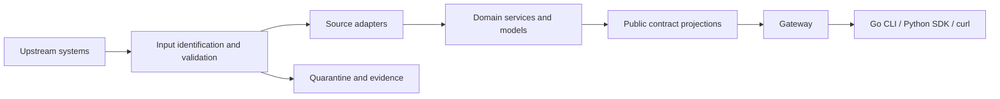
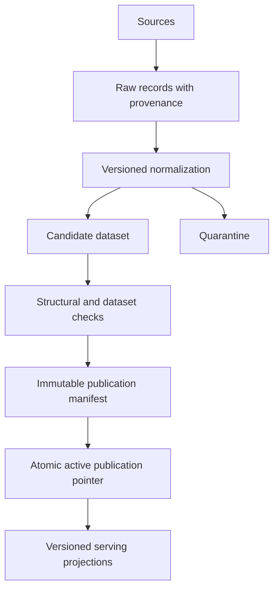

# Reference architecture and responsibility boundaries

This is a proposed design synthesized from the research. It is not a reconstruction of Azure's or Astronomer's private architecture.

## Minimum useful architecture

The logical boundaries can initially live in one deployable service. Separate services are justified by scaling, ownership, latency, or isolation needs, not by the diagram alone.

Use one domain model per bounded business area. Orders, deployment infrastructure, and arbitrary analytics tables need not share a universal object hierarchy. A universal model can hide source-specific semantics and turn every change into an organization-wide negotiation.

## Responsibility allocation

| Component | Owns | Must not silently do |
|---|---|---|
| Gateway | Authentication enforcement, routing, rate limiting, request IDs, protocol policy | Guess source meanings or route business behavior based only on User-Agent |
| Source connector | Fetching, source auth, source pagination, provenance, source errors | Claim successful complete extraction after skipped pages |
| Input boundary | Writer schema identification, validation, unknown-shape classification | Label unrecognized data as the newest schema |
| Adapter | Known semantic and structural translation | Invent missing required information |
| Domain service | Business operations and invariants | Couple public models directly to ORM/storage objects |
| Public projection | Contract-specific names, defaults, values, and error representation | Leak newly added source properties by default |
| Publication controller | Quality checks, snapshot assembly, active-pointer changes | Publish half of a multi-table dataset as a complete new snapshot |
| Registry/catalog | Immutable definitions, ownership, lifecycle, compatibility metadata | Assume registration itself validates every emitted record |
| SDK | Serialization, transport, documented client interfaces | Automatically adopt arbitrary server versions |
| CLI | Commands, workflows, presentation, stable automation output | Mix warnings into JSON stdout |

An anti-corruption layer explicitly translates across semantic boundaries. Microsoft's description supports this role for external and legacy systems; it does not require a dedicated gateway appliance or a particular deployment topology. [Azure pattern](https://learn.microsoft.com/en-us/azure/architecture/patterns/anti-corruption-layer)

## Synchronous request flow

1. Authenticate and authorize the caller and requested data product.
2. Resolve the API/data contract using explicit selection and documented defaults.
3. Capture an immutable configuration bundle for the whole request.
4. Fetch upstream with deadline and source-specific retry policy.
5. Identify the source schema and validate the actual payload.
6. Translate using the adapter selected for that schema and semantics.
7. Execute domain logic and project into the selected public contract.
8. Validate the outgoing representation and return provenance/freshness metadata appropriate to the product.

If input cannot be translated, return the documented dependency or contract error. An HTTP 200 with fabricated defaults does not preserve correctness. If an endpoint allows partial success, define its envelope, item errors, completeness indicators, and retry behavior from the first supported version.

Capture the configuration bundle once. If a hot-reloaded mapping changes halfway through a request, input validation and output translation may apply incompatible assumptions. The same principle applies to an asynchronous job and its paging cursors.

## Asynchronous ingestion and serving flow

Raw acceptance and curated publication are separate decisions. Preserve a new field in raw storage without automatically admitting it into the public schema. Keep invalid records available for investigation and replay subject to retention and access policy. Do not let a rescue column make the curated dataset appear complete when required values were diverted into it.

The raw layer can be permissive about unknown structure while still enforcing source identity, payload limits, and access controls. The curated boundary should be strict about promised invariants. Unknown extra source fields need not cause a total outage if they are irrelevant to the public projection, but changed required values must not pass merely because the parser is lenient.

## Atomic publication scope

A publication manifest can name the contract, schema, mapping bundle, source offsets or watermarks, constituent table snapshots, quality result, and creation time. Publishing means atomically replacing the active pointer with a fully validated manifest.

A table snapshot is not automatically a multi-table transaction. If orders and order lines are separate, readers must resolve both through one publication manifest or an equivalent coordinated consistency mechanism. Otherwise an order may appear without its lines even when each table individually committed atomically.

This design provides a coherent published view; it does not automatically prove the upstream extraction was transactionally consistent. A source may require snapshot isolation, change-log offsets, or explicit reconciliation to establish that stronger claim.

## Dynamic results and type systems

For arbitrary queries, the stable public contract is a result protocol: query identity, table descriptors, column descriptors, values, pagination, errors, and consistency metadata. The result schema may vary by query. Azure Monitor's documented `tables`, `columns`, and `rows` envelope is a concrete example of this distinction. [Azure Monitor result format](https://learn.microsoft.com/en-us/azure/azure-monitor/logs/api/response-format)

Even a dynamic protocol needs evolution rules. Adding a new logical type such as decimal256, a nested union, or a geometry encoding can break an old client. Define a bounded type vocabulary, extension rules, and an unknown-type strategy. A client may preserve unsupported values opaquely or request an understood encoding; it cannot safely render arbitrary future types as familiar numbers.

Use explicit numeric and temporal representations. JSON numbers may be decoded differently by different languages. Decide how to encode large integers, exact decimals, timezone-aware timestamps, and nulls. Typed Go structs and a Python dataframe conversion layer must not silently lose precision merely because the wire decoder accepted the payload.

## Curated and raw surfaces

One workable product split is:

- `/v1/orders`: owned, stable business model.
- `/v1/datasets/{id}/query`: schema-described results with a selectable published data contract where available.
- `/v1/sources/{id}/raw`: explicit passthrough/provenance surface for users accepting source coupling.

These names are illustrative. Document authorization and compatibility separately for each. Do not expose unexpected upstream properties through a generic `extras` field without considering whether their classification and access policy are known.

## Where version translation belongs

Translate source variations near the source boundary. Translate public representations near the serving boundary. Keep domain operations independent of both where possible. Business behavior that differs between public contracts must have an explicit execution path or policy; response-only mapping cannot preserve changed execution semantics.

Avoid a long chain of arbitrary pairwise transforms if it obscures meaning or compounds loss. A shared domain model reduces combinations, but it must retain enough information for every supported projection. Some old contracts cannot represent newer states. In that case specify refusal, a documented representation, or a migration requirement; do not rely on silent rounding or state collapse.

Confluent's data-contract facilities provide one concrete mechanism for declarative migration rules between producer and consumer representations. Execution support depends on the component/client and product configuration. The availability of a rule engine does not establish that a particular downgrade is lossless. [Confluent data contracts](https://docs.confluent.io/platform/current/schema-registry/fundamentals/data-contracts.html)

## Cache and cursor context

Cache identity must reflect every dimension that changes the result: tenant/authorization context, normalized query, contract, schema/encoding, mapping or publication identity, and data snapshot as appropriate. Authorization-sensitive data must not be shared because two callers requested the same URL.

A cursor should bind the original query, selected contract, publication/snapshot or documented consistency mode, and authorization context. It must not silently resume under the latest contract after a deployment. Define expiry and renewal semantics; a stable contract does not require retaining every snapshot indefinitely.

Reauthorize every continuation and cached/stale response against current access and masking policy. Pinning data interpretation does not freeze a user's privileges or retain access after revocation. If current policy changes the visible result, use the documented denial/restart behavior rather than quietly leaking historical visibility.

## Simpler alternatives and their cost

| Alternative | Benefit | Limitation |
|---|---|---|
| Direct source proxy | Minimal transformation and freshest available source data | Public consumers inherit source drift |
| Adapter in one service | Low operational overhead, owned contract | Requires strong modularity and bounded source failures |
| Materialized curated serving store | Stable reads and controlled publication | Additional latency, storage, and replay obligations |
| Separate service per API major | Strong isolation for divergent behavior | Duplicated maintenance and cross-version resource coordination |
| Generic schema-described API only | Broad dataset support | Business automation must manage data-contract dependencies |

Start with the smallest topology that enforces the actual promise. A registry, a queue, and a lakehouse are not mandatory for every CRUD API. An uncontrolled source plus a requirement for stable historical analytics is much more likely to justify staged ingestion and materialized publications.

## Architecture invariants to test

1. A successful curated response conforms to the selected public structural contract.
2. Input schemas do not implicitly become output schemas.
3. Unknown source semantics do not receive fabricated defaults.
4. A publication is visible only after checks complete at its declared scope.
5. One operation uses one resolved interpretation bundle.
6. Replay uses identified historical encodings and an explicit target mapping.
7. Quarantined data affects completeness and publication eligibility.
8. Rolling back a pointer is distinguished from undoing external side effects or restoring deleted data.
9. Supported old clients are tested as historical artifacts, not regenerated from the new specification.
10. Failure and freshness behavior are part of the compatibility contract.
